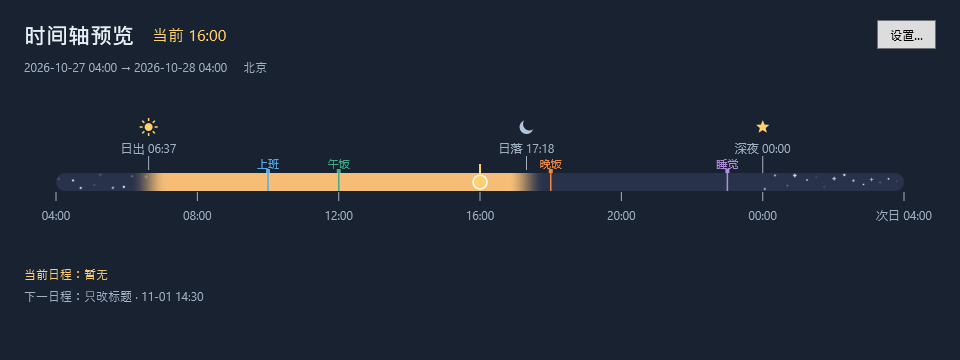
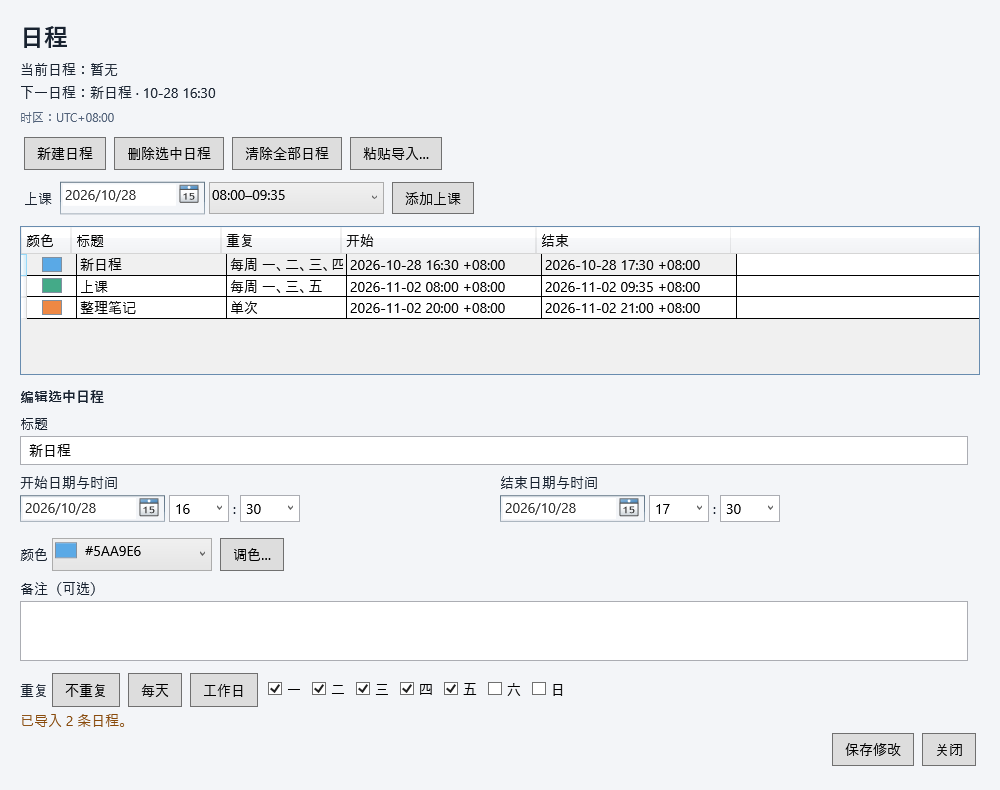

# Sunny Bar

一条贴近 Windows 任务栏的每日时间轴。以本地 **04:00 → 次日 04:00** 为一天，显示日夜渐变、当前时间和每日固定标记。

当前源码版本 **0.4.0-preview.4**，支持重复日程、AI 文本导入、上课预设和深夜星光。已发布便携版为 **0.3.0-preview.4**，下载包与当前源码的功能可能不同。



以上为固定时钟、北京预设和隔离演示数据生成的 WPF 截图，不含用户实际日程；截图中的星点是静态的，运行时会轻微闪烁。

## 直接运行便携版

1. 从 [GitHub Releases](https://github.com/Cloud7-17/SunnyBar/releases/tag/v0.3.0-preview.4) 获取 `SunnyBar-0.3.0-preview.4-win-x64.zip`，不要下载自动生成的 Source code。0.4 源码可自行构建；CI 成功后也会生成 `SunnyBar-win-x64` 构建产物。
2. **完整解压**，双击 `SunnyBar.App.exe`。不需要 .NET、SDK、管理员权限或脚本。
3. 默认北京，可打开设置修改地点，然后点击“保存并应用”。

请保留 EXE 同目录的所有文件。Windows 11 x64 为主要目标；Windows 10 与第二台无 .NET 电脑仍待验收。源码托管于 [Cloud7-17/SunnyBar](https://github.com/Cloud7-17/SunnyBar)，便携包通过 Releases 分发。

## 日常使用

- 从系统托盘太阳图标打开设置、显示/隐藏时间条或退出。图标可能位于隐藏图标区域；关闭设置窗口后仍会常驻。
- 默认全宽贴住任务栏上沿，不显示小时刻度。双击可见色条打开编辑器，单击不激活；上方空白与悬停信息浮层穿透。悬停提供时间、标记和日程倒计时。
- 标记可分别输入/选择时、分，使用可见色板或调色盘；一键预设为上班 10:00、午饭 12:00、晚饭 18:00、睡觉 23:00。
- 当前指针可选圆点、星形、Emoji 或 PNG。PNG 保存到本机副本，丢失时回退圆点。
- 所有设置保存在 `%LocalAppData%\SunnyBar`；重启恢复，损坏先备份再回退。相同用户的开发版和便携版共用配置与单实例锁。
- 开机启动默认关闭，可在“运行”页主动勾选并保存。便携版直接注册 EXE，移动应用目录后需重新保存。

- 00:00 星形标记区分夜晚与深夜，午夜到日出的条段叠加细闪星点；关闭系统动画时改为静态显示。
- 编辑、导入、预览、EXE 与托盘使用统一太阳图标；预览仅显示必要时间与日程信息。

完整操作、升级和卸载见 [便携使用说明](docs/PORTABLE_GUIDE.md)，高级恢复见 [设置说明](docs/SETTINGS.md)。

## 日程与重复规则（0.4）

双击时间条或从托盘“日程…”进入，左侧切换日程、每日标记和其他设置。

- “新建日程”立即添加，编辑后点击“保存修改”；新日程自动使用未被已有日程占用的颜色。
- 重复支持每天、工作日或指定星期；工作日仅指周一至周五，不处理节假日调休。编辑/删除作用于整个系列，暂不支持单次例外。
- “上课”预设提供 08:00–09:35、09:50–11:25、09:50–12:15、13:30–15:05、15:20–16:55、19:20–20:55、19:20–21:45 七个时段，选日期后添加一条日程。
- 色带默认占顶部 40%，起止竖线贯穿条高；跨 04:00 裁剪、重叠分层，并显示当前/下一日程和倒计时。
- 日程和每日标记各有独立的“清除全部”，确认后立即保存，取消不修改数据。

日程保存在 `%LocalAppData%\SunnyBar\events.json`。重复规则使用格式版本 2；旧版应用会保留文件并禁止覆盖，请用新版继续编辑。详见 [日程说明](docs/SCHEDULES.md)。



## AI 规划与批量导入

让 AI 按 [导入格式与提示词](docs/SCHEDULE_IMPORT.md) 生成 JSON，在日程页点击“粘贴导入…”，核对预览后确认追加。格式模板可在导入窗口复制；导入不会替换已有日程，重复导入会重复添加，非法文本整批拒绝。

```json
{"version":1,"timeZone":"Asia/Shanghai","events":[
  {"title":"上课","date":"2026-11-02","start":"08:00","end":"09:35","days":[1,3,5]},
  {"title":"整理笔记","date":"2026-11-02","start":"20:00","end":"21:00"}
]}
```

`days` 用 1–7 表示周一至周日，省略即单次。日期和时区必须明确；结束早于开始表示次日结束。最多 1000 条（含已有规则）。应用不会连接 AI、执行文本中的指令或上传你的日程。

## 验证状态与限制

逻辑测试 157 个，覆盖时间边界、DST、太阳/深夜、配置恢复、日程与重复、导入校验和倒计时。另有隔离 WPF 绑定/渲染、原生窗口图标及双击入口、便携包校验与启动检查。已执行结果见 [VALIDATION](docs/VALIDATION.md)，云端状态以 [Actions](https://github.com/Cloud7-17/SunnyBar/actions) 为准。

首版只保证主屏、底部非自动隐藏任务栏；实际 150%/200% 缩放、休眠唤醒、跨夜常驻、注销登录启动及干净电脑仍待验证，见 [发布验收清单](docs/RELEASE_CHECKLIST.md)。目前为未签名预览版，稳定发布、安装器和自动更新尚未完成。

日出日落为离线估算，使用系统时区；选择城市不会切换时区。多屏选择、全屏自动隐藏、极薄/任务栏融合/悬停展开、提醒通知和外部日历同步未实现。

## 从源码开发

需要 Windows 与 .NET SDK 10.0.403（global.json 已固定版本）。在项目根目录执行：

```powershell
dotnet restore SunnyBar.slnx
dotnet build SunnyBar.slnx -c Release --no-restore
dotnet test SunnyBar.slnx -c Release --no-build --no-restore
dotnet run --project src/SunnyBar.App
```

本机隔离 SDK 位于 `.tools/dotnet/dotnet.exe`，未修改 PATH。复用本机缓存时先设置：

```powershell
$env:DOTNET_CLI_HOME = Join-Path $PWD '.tools/cli-home'
$env:NUGET_PACKAGES = Join-Path $PWD '.tools/nuget'
```

将命令中的 dotnet 替换为 `./.tools/dotnet/dotnet.exe` 即可。原开发入口 `scripts/run.cmd` 仍可双击启动 Debug 构建；修改源码后先构建。`scripts/run.ps1 -Preview` 可打开详细预览。

可重复发包命令、文件校验和 CI 说明见 [BUILD](docs/BUILD.md)。Windows CI 文件位于 `.github/workflows/build.yml`；推送后自动执行，结果见 [Actions](https://github.com/Cloud7-17/SunnyBar/actions)。

## 隐私与许可

应用离线运行，不自动定位、联网、登录或采集遥测；详见 [隐私说明](docs/PRIVACY.md)。源码采用 [MIT](LICENSE)，自包含包保留微软运行时许可证，见 [第三方说明](THIRD_PARTY_NOTICES.md)。

[产品计划](docs/PRODUCT_PLAN.md) · [变更记录](docs/CHANGELOG.md) · [太阳计算](docs/SOLAR_CALCULATION.md) · [未来显示候选](docs/FUTURE_DISPLAY_OPTIONS.md)
