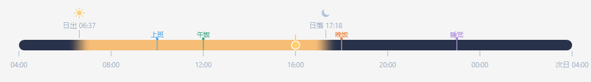
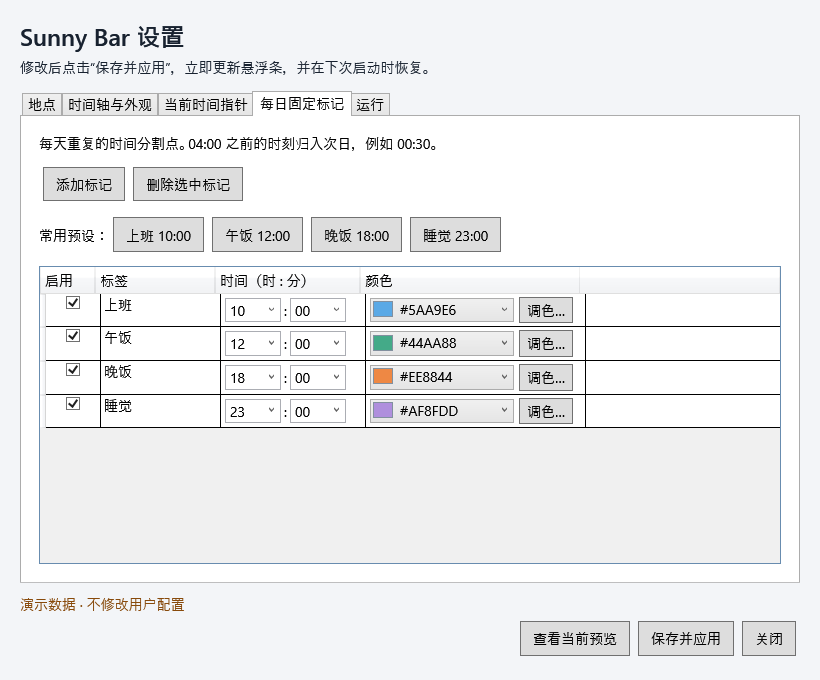
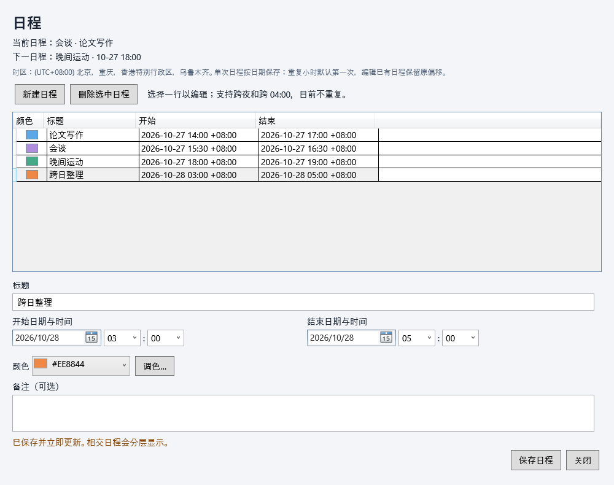

# Sunny Bar

一条贴近 Windows 任务栏的每日时间轴。以本地 **04:00 → 次日 04:00** 为一天，显示日夜渐变、当前时间和每日固定标记。

当前开发版本 **0.3.0-preview.1**，新增本地单次日程。已发布版本为 0.2.0-preview.1；多 DPI 等兼容验收继续进行。



以上为固定时间与北京预设生成的 WPF 演示图，不是自动获取的用户位置。

## 直接运行便携版

1. 从 [GitHub Releases](https://github.com/Cloud7-17/SunnyBar/releases) 获取 `SunnyBar-0.2.0-preview.1-win-x64.zip`；本机构建输出位于 `artifacts/releases/`。
2. **完整解压**，双击 `SunnyBar.App.exe`。不需要 .NET、SDK、管理员权限或脚本。
3. 默认北京，可打开设置修改地点，然后点击“保存并应用”。

请保留 EXE 同目录的所有文件。Windows 11 x64 为主要目标；Windows 10 与第二台无 .NET 电脑仍待验收。源码托管于 [Cloud7-17/SunnyBar](https://github.com/Cloud7-17/SunnyBar)，便携包通过 Releases 分发。

## 日常使用

- 从系统托盘太阳图标打开设置、显示/隐藏时间条或退出。图标可能位于隐藏图标区域；关闭设置窗口后仍会常驻。
- 默认全宽贴住任务栏上沿，不显示小时刻度，点击穿透。停留约半秒显示当前时间、下一标记和剩余时间。
- 标记可分别输入/选择时、分，使用可见色板或调色盘；一键预设为上班 10:00、午饭 12:00、晚饭 18:00、睡觉 23:00。
- 当前指针可选圆点、星形、Emoji 或 PNG。PNG 保存到本机副本，丢失时回退圆点。
- 所有设置保存在 `%LocalAppData%\SunnyBar`；重启恢复，损坏先备份再回退。相同用户的开发版和便携版共用配置与单实例锁。
- 开机启动默认关闭，可在“运行”页主动勾选并保存。便携版直接注册 EXE，移动应用目录后需重新保存。



完整操作、升级和卸载见 [便携使用说明](docs/PORTABLE_GUIDE.md)，高级恢复见 [设置说明](docs/SETTINGS.md)。

## 单次日程（0.3 开发版）

从托盘“日程…”或设置“管理日程…”进入，支持新增、编辑、删除、日期与时分选择、颜色和备注。本地保存到 events.json，重启恢复；跨 04:00 区间裁剪、重叠分层、当前高亮和当前/下一日程已接入。详见 [日程说明](docs/SCHEDULES.md)。



## 验证状态与限制

逻辑测试 120 个，覆盖时间边界、DST、太阳事件、配置恢复、标记与倒计时。已验证的实际命令和结果见 [VALIDATION](docs/VALIDATION.md)。

首版只保证主屏、底部非自动隐藏任务栏；实际 150%/200% 缩放、休眠唤醒、跨夜常驻、注销登录启动及干净电脑仍待验证，见 [发布验收清单](docs/RELEASE_CHECKLIST.md)。公开稳定发布、安装器和 GitHub Release 尚未完成。

日出日落为离线估算，使用系统时区；选择城市不会切换时区。多屏选择、全屏自动隐藏、极薄/任务栏融合/悬停展开、重复日程和外部日历同步未实现。

## 从源码开发

需要 Windows 与 .NET SDK 10.0.403（global.json 已固定版本）。在项目根目录执行：

```powershell
dotnet restore SunnyBar.slnx
dotnet build SunnyBar.slnx -c Release --no-restore
dotnet test SunnyBar.slnx -c Release --no-build --no-restore
dotnet run --project src/SunnyBar.App
```

本机隔离 SDK 位于 `.tools/dotnet/dotnet.exe`，未修改 PATH。复用本机缓存时先设置：

```powershell
$env:DOTNET_CLI_HOME = Join-Path $PWD '.tools/cli-home'
$env:NUGET_PACKAGES = Join-Path $PWD '.tools/nuget'
```

将命令中的 dotnet 替换为 `./.tools/dotnet/dotnet.exe` 即可。原开发入口 `scripts/run.cmd` 仍可双击启动 Debug 构建；修改源码后先构建。`scripts/run.ps1 -Preview` 可打开详细预览。

可重复发包命令、文件校验和 CI 说明见 [BUILD](docs/BUILD.md)。Windows CI 文件位于 `.github/workflows/build.yml`；推送后自动执行，结果见 [Actions](https://github.com/Cloud7-17/SunnyBar/actions)。

## 隐私与许可

应用离线运行，不自动定位、联网、登录或采集遥测；详见 [隐私说明](docs/PRIVACY.md)。源码采用 [MIT](LICENSE)，自包含包保留微软运行时许可证，见 [第三方说明](THIRD_PARTY_NOTICES.md)。

[产品计划](docs/PRODUCT_PLAN.md) · [变更记录](docs/CHANGELOG.md) · [太阳计算](docs/SOLAR_CALCULATION.md) · [未来显示候选](docs/FUTURE_DISPLAY_OPTIONS.md)
